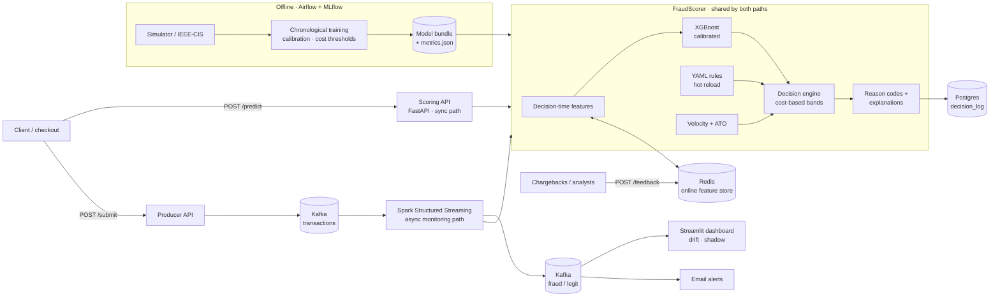

# Real-time fraud detection: streaming, ML + rules, explainable decisions

[](../../actions/workflows/tests.yml)

An end-to-end card-fraud system built as a final-year project. It scores each payment
**synchronously** (approve / review / hold / block, with reasons), monitors the stream
**asynchronously**, and retrains offline with an honest, out-of-time evaluation.

It follows the design used by production fraud platforms (Stripe Radar, Nubank, Monzo, Uber).
The research behind each design choice is in [docs/research/](docs/research/production-fraud-detection-systems.md).

---

## Architecture



| Path | Latency budget | Used for |
|---|---|---|
| **Sync**: `scoring-api` `POST /predict` | inside the payment request | approve / review / hold / block |
| **Async**: Kafka → Spark (micro-batch) | seconds | dashboard, alerts, monitoring |

Both paths call the same `FraudScorer` (`src/inference/scoring.py`), so they always make the same decision.

---

## Key design decisions

1. **Score synchronously, monitor asynchronously.** A payment cannot wait for a 5–10 s micro-batch, so the decision is made by the sync API. Spark Structured Streaming handles post-authorization monitoring. At larger scale, Flink would compute per-event streaming features into the online store (see *Limitations*).
2. **Two models, two datasets, each used for what it can prove.**
   - **IEEE-CIS benchmark** (`ieee_cis_training.py`) validates the modelling on real fraud. Its anonymised V/C/D/id columns do not exist in an authorization request, so this model is **not** the one served live.
   - **The decision-time model** (`train_decision_time.py`) is served live. It is trained on simulated transactions ([simulator](src/dags/simulator.py), Fraud Detection Handbook design plus account-takeover and card-testing scenarios) using only features available when the payment arrives.
3. **One feature definition.** `decision_time_features.py` computes features offline (replaying history through an in-memory store) and online (Redis) with the same code. A test asserts that both produce identical features. This came out of a real incident: see the [train/serve-skew postmortem](docs/postmortem-train-serve-skew.md).
4. **Honest evaluation.**
   - Splits are chronological: train / early-stop / calibration / gap / test.
   - Statistics are fitted on the training period only.
   - Target encoding of training rows is out-of-fold.
   - No SMOTE: class imbalance is handled with `scale_pos_weight`.
   - Reported metrics: AUC-PR, recall at a fixed FPR, precision@k per day (analyst budget), dollar recall, and a **rules-only baseline**.
5. **Thresholds from money, not F1.** BLOCK is set where expected fraud loss exceeds the cost of declining a good customer ([`evaluation.py`](src/dags/evaluation.py)). The REVIEW band is sized to a daily analyst budget.
6. **Rules + ML.** The model ranks risk from many weak signals. Rules in [`rules.yaml`](src/inference/rules.yaml) cover known patterns, are hot-reloaded, and can block immediately during an attack (emergency rule live in under a minute, no deploy).
7. **Label delay is part of the design.** Frauds only become labels when their chargeback arrives, 7–60 days later in simulation. Training happens "on day 150" with the labels known then. Terminal-risk features only see reported frauds, through `POST /feedback` online and replay offline.
8. **Explainable and auditable.**
   - Every decision carries reason codes: rule hits, velocity/ATO signals, and the model's top TreeSHAP contributions.
   - Explanations are rendered from fixed templates, so they can only state factors that actually fired.
   - Every decision is written to `decision_log` (inputs, features, scores, thresholds, model and rule versions).
9. **Reliability and security on the payment path.**
   - Scoring has a latency budget. If the model errors or is too slow, the API returns a rules-only decision marked `degraded` instead of failing the payment (fail safe to REVIEW by default).
   - Kafka/Spark deliver at-least-once, so decisions are cached by transaction ID: a replay or client retry gets the original decision and is not counted twice in velocity.
   - Both APIs require an `X-API-Key`.
10. **Safe model changes.** A challenger can run in **shadow mode** (`SHADOW_MODEL_BUNDLE_PATH`): it scores live traffic but is never acted on. The dashboard compares it with the champion and tracks score drift (PSI).

---

## Results

All numbers come from files the training and benchmark scripts generate. Nothing below is hand-written.

| Model (out-of-time test split) | Source file |
|---|---|
| Decision-time (served live) | `src/models/metrics_decision_time.json` |
| IEEE-CIS benchmark | `src/models/metrics_ieee_cis.json` |
| Sync API latency (p50 / p95 / p99) | `results/latency_*.json` |

Each metrics file reports, on the test split:
- **Model results:** AUC-ROC, average precision (compare it with the fraud prevalence), recall at FPR 0.1% / 0.5% / 1%, precision@100 per day, dollar recall, and net savings under the cost model.
- **Baselines:** the rules-only baseline and rules + model.
- **Per-scenario recall:** reported for the decision-time model.

> For reference, the IEEE-CIS Kaggle winners reached about 0.946 private-leaderboard AUC with an ensemble. A realistic out-of-time score for one GBDT is about 0.92–0.95; anything far above that should be checked for leakage.

---

## Quick start

Prerequisites: Docker with Compose and 8+ GB RAM. For running tests locally, use Python 3.10.

```bash
cd src
cp .env.example .env            # fill in Kafka (Confluent) credentials
docker compose up -d --build    # Kafka clients, Spark, scoring API, Redis, Postgres, Airflow, MLflow, dashboard
```

1. **Train the live model.** In Airflow (http://localhost:8080) trigger `decision_time_fraud_training`. It simulates data on the first run, then trains and writes `models/decision_time_model.pkl` and its metrics.
2. *(Optional)* **Train the benchmark model.** Put `train_transaction.csv` and `train_identity.csv` in `src/data/ieee_cis/`, then trigger `ieee_cis_fraud_detection_training`.
3. Restart the scorers so they load the model: `docker compose restart inference-spark scoring-api`.
4. **Demo:**
   ```bash
   python scripts/stream_synthetic.py --target predict --attack card_testing   # sync path, live attack
   python scripts/stream_synthetic.py --target kafka --attack ato              # async path → dashboard
   python scripts/benchmark_latency.py --n 2000 --concurrency 8
   ```
   Dashboard: http://localhost:8501 · MLflow: http://localhost:5500 · Emails: http://localhost:1080

API examples, the emergency-rule demo and audit-log queries are in [src/inference/API_TESTING.md](src/inference/API_TESTING.md).

---

## Repository layout

```
src/
  producer/app.py                  POST /api/v1/transactions/submit → Kafka
  inference/
    scoring.py                     FraudScorer (shared by both serving paths)
    api_direct.py                  sync API: /predict, /feedback
    main_inference.py              Spark Structured Streaming job
    decision_engine.py             hybrid thresholds → APPROVE/REVIEW/HOLD/BLOCK
    rule_engine.py, rules.yaml     hot-reloaded declarative rules
    feature_store.py               Redis feature store (online twin of MemoryStore)
    velocity_service.py, ato_service.py, explanations.py, audit_log.py
  dags/
    decision_time_features.py      live-model features (offline + online)
    simulator.py                   synthetic transactions with delayed chargebacks
    train_decision_time.py         live model training   (+ Airflow DAG)
    feature_pipeline.py            IEEE-CIS features, fitted on train period only
    ieee_cis_training.py           benchmark training    (+ Airflow DAG)
    evaluation.py                  metrics, cost thresholds, PSI
  dashboard/app.py                 Streamlit: transactions, alerts, drift, shadow
  sql/decision_log.sql             audit table
tests/                             pytest (runs in CI without Kafka/Spark/Redis)
scripts/                           demo traffic, latency benchmark
docs/                              postmortem, research report
```

Run the tests: `pip install -r requirements-dev.txt && pytest`. Tests that need trained artifacts skip automatically.

---

## Limitations (and what I would do at scale)

- **Simulated live data.** The served model learns simulator patterns, so its scores show the system works end to end, not real-world accuracy. Real-world modelling is shown on IEEE-CIS.
- **Spark micro-batch** is used only for asynchronous monitoring. At scale: Flink for per-event, exactly-once streaming features into the online store.
- **Redis as the feature store.** At scale: a managed feature store (Feast/Tecton) with point-in-time training sets from a warehouse.
- **Basic graph signal.** The only graph signal is "customers per device". At scale: batch entity graphs (shared devices, cards, emails) with community detection, fed in as features.
- **No case-management UI.** Analyst decisions enter only through `POST /feedback`.
- **Blocked transactions never get labels.** Production systems let a small random slice through and weight it by inverse propensity (Stripe). Here this is documented but not implemented.
- **Single-node deployment.** No horizontal-scaling or load results beyond `benchmark_latency.py`.

---

## Background

This repository grew out of the thesis *Streaming Data-Driven Fraud Detection for Transactions using ML* (BSc (Hons) IT, General Sir John Kotelawala Defence University, 2025). The thesis compared LightGBM, XGBoost and CatBoost under its own protocol. The code here has since been re-engineered around the protocol above, so the numbers in the metrics files supersede those in the thesis.

Dataset: [IEEE-CIS Fraud Detection](https://www.kaggle.com/c/ieee-fraud-detection) (Kaggle competition terms). For academic use.
